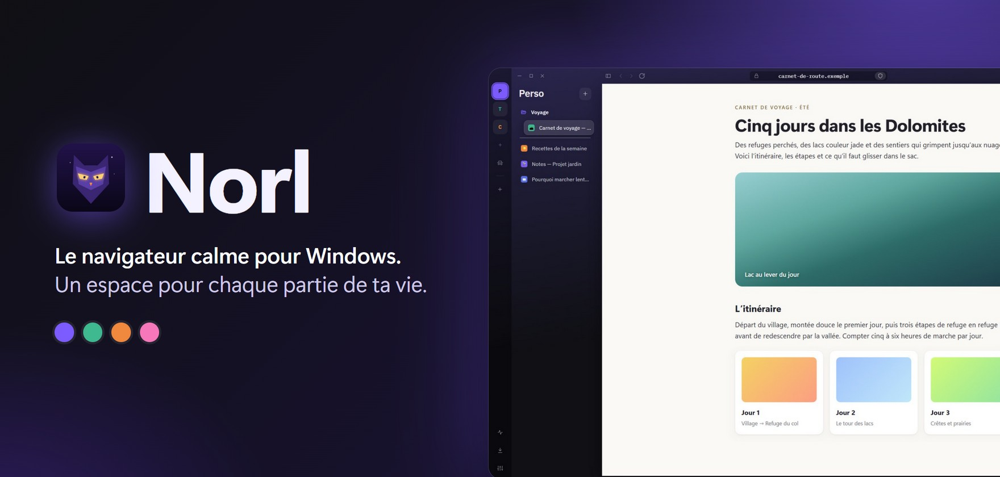
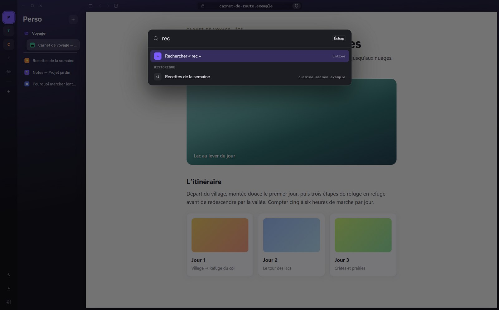
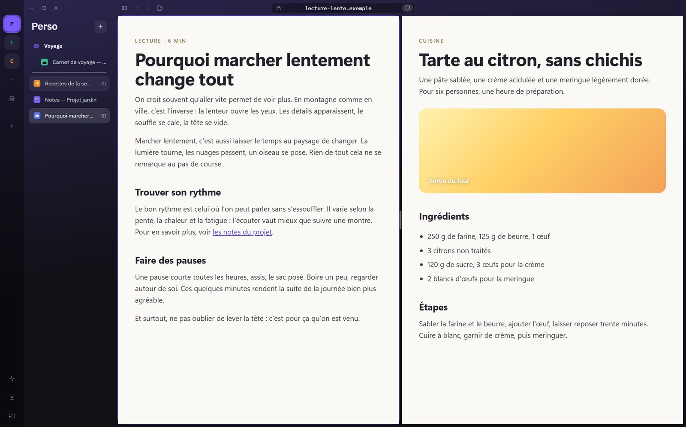
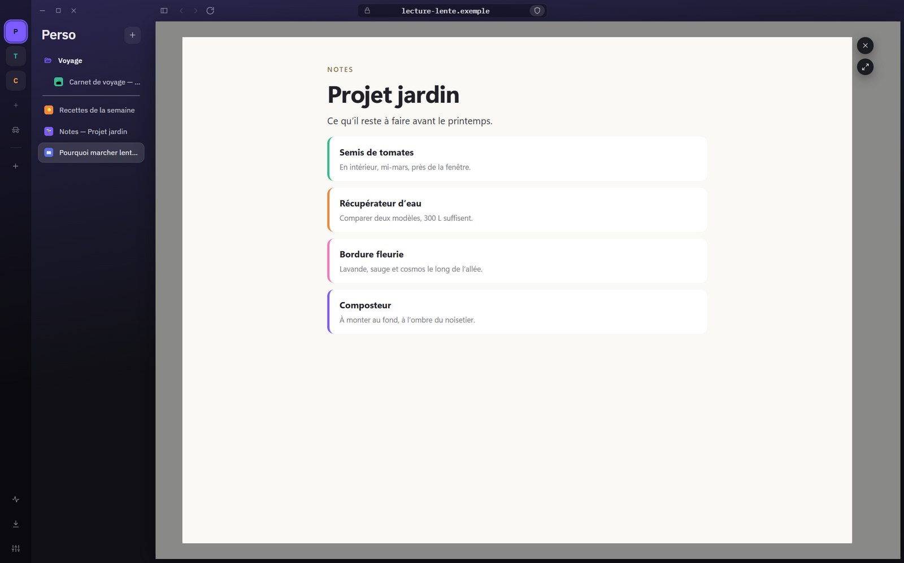
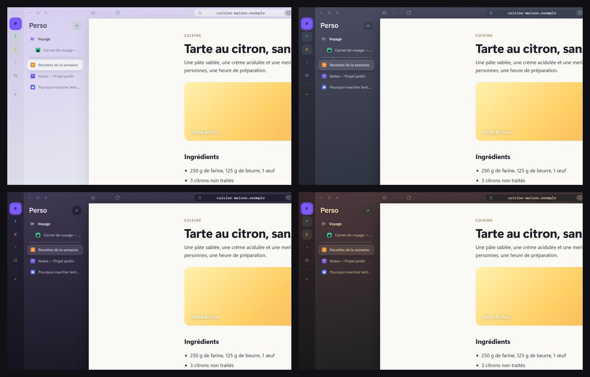

  

<h3 align="center">Onglets verticaux, espaces, aperçu des liens, bloqueur de pubs.</h3>

Gratuit. Sans pub. Sans compte. Sans pistage.

  

  
  
  
   
  mises à jour automatiques · <a href="#in-english">English below</a>

 

## Pourquoi Norl

<table>
  <tr>
    <td width="50%" valign="top">
      <h3>🗂️ Rangé</h3>
      Un <b>espace</b> pour chaque partie de ta vie (perso, travail, cours), chacun avec ses onglets, ses comptes et sa couleur. Des <b>dossiers</b> pour ranger les onglets qui vont ensemble.
    </td>
    <td width="50%" valign="top">
      <h3>🛡️ Privé</h3>
      Bloqueur de pubs et de traqueurs intégré, HTTPS partout, liens nettoyés. Pas de compte à créer, rien n'est envoyé nulle part.
    </td>
  </tr>
  <tr>
    <td width="50%" valign="top">
      <h3>⌨️ Au clavier</h3>
      <b>Ctrl+T</b> ouvre la palette : une adresse, une recherche, un onglet déjà ouvert, une commande, un calcul. Presque tout se fait sans la souris.
    </td>
    <td width="50%" valign="top">
      <h3>🎨 À ton goût</h3>
      Des dizaines de thèmes (Catppuccin, Nord, Rosé Pine…), un pour le jour et un pour la nuit, trois densités d'interface, et du CSS perso pour qui veut aller plus loin.
    </td>
  </tr>
</table>

## En images

**La palette (Ctrl+T)** : on tape, Norl propose l'historique, les onglets ouverts et les commandes.

**La vue scindée** : deux pages côte à côte, en glissant un onglet sur la page.

**L'aperçu (Peek)** : Maj+clic sur un lien l'ouvre par-dessus la page, sans créer d'onglet.

**Les thèmes** : clair ou sombre, à choisir dans une bibliothèque ou à créer soi-même.

## Installer

1. **[Télécharger Norl](https://github.com/olprezv/Norl-versions/releases/latest/download/Norl-Setup.exe)** (le fichier `Norl-Setup.exe`, toujours la dernière version).
2. Lancer l'installeur. Windows affiche « Windows a protégé votre ordinateur » (SmartScreen), parce que l'installeur n'est pas signé (la signature est payante) : cliquer sur **Informations complémentaires**, puis **Exécuter quand même**.
3. Choisir le dossier d'installation. Un raccourci Norl est créé sur le bureau et dans le menu Démarrer.

## Mises à jour

Norl vérifie au démarrage, puis toutes les heures, si une nouvelle version est publiée. Si oui, une petite icône apparaît à droite du bouclier, dans la barre d'adresse ; son infobulle liste les nouveautés.

- Un clic télécharge la mise à jour en arrière-plan (on continue de naviguer).
- Quand l'icône devient verte (« Redémarrer pour installer »), un clic ferme Norl, installe la nouvelle version et le rouvre avec les mêmes onglets.
- Rien ne s'installe sans ce clic. Les favoris, l'historique et les réglages sont gardés.
- Réglages → Mises à jour : la version installée et « Voir les nouveautés » (la liste de toutes les versions).

## Tout ce qu'il sait faire

<b>Espaces, dossiers et favoris</b>

 

- **Espaces** : chaque espace a ses onglets, sa couleur et son propre profil (cookies, comptes, cache, historique séparés). Pastilles dans la barre latérale, clic droit pour renommer, changer la couleur ou supprimer (ses données sont effacées avec lui).
- **Favoris** épinglés en grille en haut de la barre latérale (Ctrl+D pour ajouter ou retirer la page).
- **Dossiers d'onglets** : clic droit sur un onglet → « Créer un dossier » (il prend le nom de l'onglet). Clic droit sur le dossier pour le renommer, changer sa couleur ou le supprimer (fermer ses onglets ou les garder). On y range les onglets en les glissant ou par clic droit ; un lien ouvert depuis un onglet de dossier y reste. Les dossiers et leurs onglets reviennent au lancement, en veille (rien ne se charge avant un clic).
- **Espace privé** (bouton masque de la barre latérale) : ni historique ni cookies gardés ; tout est effacé quand il se ferme (clic droit, ou dernier onglet fermé).
- **Espace verrouillé** : un espace caché derrière un code (Ctrl+Maj+L pour l'ouvrir).
- **Page Nouvel onglet** personnalisable, espace par espace.
- **Panneaux latéraux** : une page gardée à côté de celle qu'on lit (Ctrl+Maj+B pour l'afficher ou la masquer).

<b>Navigation</b>

 

- **Palette** (Ctrl+T) : adresse, recherche, historique de l'espace, onglets ouverts, commandes du navigateur ; propose la suite d'une adresse déjà visitée (Tab pour l'accepter) ; fait les calculs (« 12 % de 349,90 ») et lance des minuteurs (« 10 min »).
- **Aperçu (Peek)** : Maj+clic sur un lien l'ouvre dans une fenêtre flottante par-dessus la page, sans créer d'onglet. ✕, Échap ou un clic à côté la ferment ; ⤢ l'ouvre en onglet sans la recharger. Pendant l'aperçu, la barre d'adresse et le cadenas montrent sa page.
- **Vue scindée** : glisser un onglet sur la page l'ouvre à gauche ou à droite ; séparateur déplaçable (double-clic pour centrer).
- **Historique** dans `norl://history` (Ctrl+H) : l'historique de l'espace, avec recherche ; la palette ne propose que celui de l'espace affiché.
- **Mots-clés de recherche** dans la palette et l'adresse : `!gh norl` cherche sur GitHub, `!claude`, `!gemini`, `!yt`, `!w` (Wikipédia), `!asura`, `!discord` ; liste modifiable dans les réglages.
- **Vidéo en incrustation** (Ctrl+Maj+P) et mini-lecteur pour garder une vidéo à l'œil en changeant d'onglet.

<b>Vie privée et sécurité</b>

 

- **Bloqueur de publicités et de traqueurs** (EasyList/EasyPrivacy) : bouclier dans la barre d'adresse avec le nombre d'éléments bloqués, désactivable par site.
- **Sécurité** : carte du site (clic sur le cadenas) avec permissions par site demandées à la volée, HTTPS uniquement, pages d'erreur de certificat, cookies tiers à la demande, liens nettoyés, DNS chiffré en option, confirmation avant d'ouvrir un fichier exécutable. L'installeur durcit Norl.exe (Electron Fuses).
- **Mots de passe** : gestionnaire intégré protégé par un code, proposé après une connexion réussie, avec un bilan des mots de passe faibles, réutilisés ou ayant fuité.
- **Remplissage des formulaires** (adresse, coordonnées) à partir de fiches enregistrées.

<b>Confort et outils</b>

 

- **Téléchargements** : enregistrés directement dans le dossier Téléchargements, progression dans la barre latérale, liste complète dans `norl://downloads` (Ctrl+J).
- **Confort** : recherche dans la page (Ctrl+F, Tab / Maj+Tab pour passer d'un résultat à l'autre), icône 🔊 / 🔇 sur les onglets qui jouent du son, mise en veille des onglets cachés depuis 5 minutes (réglable, jamais pour Discord ni pour un onglet qui joue du son ou où tu as commencé à taper).
- **Statistiques** du temps passé par site et par espace, **gestionnaire de tâches** (Maj+Échap), **pipette** à couleurs, **code QR** de la page, **surveillance** d'une page qui change.
- **Palette depuis n'importe où** : Maj+Alt+Espace ouvre Norl et sa palette, même quand il est en arrière-plan.

<b>Apparence</b>

 

- **Thèmes** : une bibliothèque de thèmes de couleurs (Catppuccin, Nord, Dracula, Gruvbox, Tokyo Night, Rosé Pine, Solarized, GitHub…) et de thèmes complets (couleurs, polices, arrondis, marges), un thème pour le jour et un pour la nuit, essai en direct au survol, thèmes perso à créer, importer et exporter (`.norl-theme.json`). Transparence Mica ou Acrylique de Windows 11.
- **Densité** de l'interface : Compact, Normal ou Aéré.
- **Disposition** : onglets verticaux ou horizontaux, barre latérale à gauche ou à droite, boutons de la fenêtre à gauche ou tout à droite.
- **Réglages** dans `norl://settings` (bouton ⚙) : moteur de recherche, thème, couleurs, disposition, espaces, bloqueur, téléchargements, démarrage, avec une recherche en haut de la page. Section « Données » : taille du cache de chaque espace, vider le cache, effacer l'historique ou les cookies et données des sites (déconnecte les comptes de l'espace), taille maximale du cache.

<b>Raccourcis</b>

 

Raccourcis par défaut, modifiables dans `norl://settings` → Raccourcis (sauf Ctrl+chiffre, Ctrl+Maj+chiffre et le zoom, liés à la touche physique).

| Raccourci | Action |
| --- | --- |
| Ctrl+T | Palette : nouvel onglet, historique, commandes du navigateur |
| Maj+Alt+Espace | Ouvrir Norl et la palette, depuis n'importe où |
| Ctrl+L | Modifier l'adresse |
| Ctrl+W | Fermer l'onglet (sans onglet ouvert : fermer le navigateur) |
| Ctrl+Maj+T | Rouvrir le dernier onglet fermé (même après redémarrage) |
| Ctrl+D | Épingler / retirer la page des favoris |
| Ctrl+Maj+1…9 | Aller à l'espace n |
| Ctrl+Maj+S | Vue scindée : onglet actif et précédent côte à côte / fermer |
| Ctrl+Maj+B | Afficher / masquer le panneau latéral |
| Ctrl+Maj+L | Ouvrir l'espace verrouillé |
| Ctrl+Maj+P | Vidéo en incrustation |
| Ctrl+Maj+C | Copier l'adresse de la page |
| Ctrl+, | Réglages |
| Ctrl+J | Téléchargements |
| Ctrl+H | Historique de l'espace |
| Ctrl+F | Rechercher dans la page (Tab : suivant, Maj+Tab : précédent) |
| Ctrl+M | Couper / remettre le son de l'onglet |
| Ctrl+S | Afficher/masquer la barre latérale (masquée, elle réapparaît au survol du bord) |
| Ctrl+Tab / Ctrl+Maj+Tab | Onglet suivant / précédent |
| Ctrl+1…8, Ctrl+9 | Aller à l'onglet n / au dernier (touches physiques : fonctionne aussi en AZERTY) |
| Alt+← / Alt+→ | Précédent / suivant |
| Ctrl+R, F5 / Ctrl+Maj+R, Ctrl+F5 | Actualiser / sans cache |
| Ctrl+= / Ctrl+- / Ctrl+0 | Zoom |
| Maj+Échap | Gestionnaire de tâches |
| F12 | Outils de développement de la page |
| Ctrl+Maj+I (depuis l'interface) | Outils de développement de l'interface |

<b>Personnalisation et données</b>

 

La page `norl://settings` (bouton ⚙, Ctrl+,) couvre les réglages courants. Tout est enregistré dans `%APPDATA%\Norl\` (bouton « Ouvrir le dossier » dans les réglages) :

- `settings.json` : tous les réglages, modifiables à la main (rechargés à chaud).
- `userChrome.css` : CSS libre appliqué à l'interface.
- `sites/<domaine>.css` et `sites/<domaine>.js` : CSS et JavaScript personnels par site (`youtube.com.css` s'applique à YouTube et à ses sous-domaines). Depuis une page : Ctrl+T puis « Modifier le CSS de ce site ».

## Questions

<b>C'est vraiment gratuit ?</b>

 

Oui. Pas de pub, pas de compte, pas d'abonnement, et rien n'est collecté sur ta navigation.

<b>Pourquoi Windows affiche un avertissement (SmartScreen) ?</b>

 

L'installeur n'est pas signé : la signature de code est payante. Windows prévient donc à la première installation. Clique sur **Informations complémentaires**, puis **Exécuter quand même**. Les mises à jour suivantes s'installent depuis Norl.

<b>Et sur Mac ou Linux ?</b>

 

Pas pour l'instant : Norl est fait pour Windows 10 et 11.

<b>Ce qui ne marche pas encore</b>

 

- Pas de Netflix, Disney+ ni autre vidéo protégée (Widevine absent).
- Pas d'extensions Chrome.
- Installeur non signé : avertissement SmartScreen à la première installation.

<b>Désinstaller</b>

 

Paramètres Windows → Applications → Applications installées → Norl → Désinstaller. Les données de `%APPDATA%\Norl` restent : les supprimer à la main pour tout effacer.

## In English

Norl is a calm, free web browser for Windows 10 and 11, inspired by Arc: vertical tabs, spaces with separate accounts, tab folders, link previews, split view, a built-in ad and tracker blocker, and dozens of themes. No ads, no account, no tracking. The interface is in French.

**[Download Norl for Windows](https://github.com/olprezv/Norl-versions/releases/latest/download/Norl-Setup.exe)**. Windows SmartScreen will warn you because the installer is not signed: click **More info**, then **Run anyway**. Norl then updates itself.

 

   
  Ce dépôt contient les installeurs de Norl et ce mode d'emploi.

